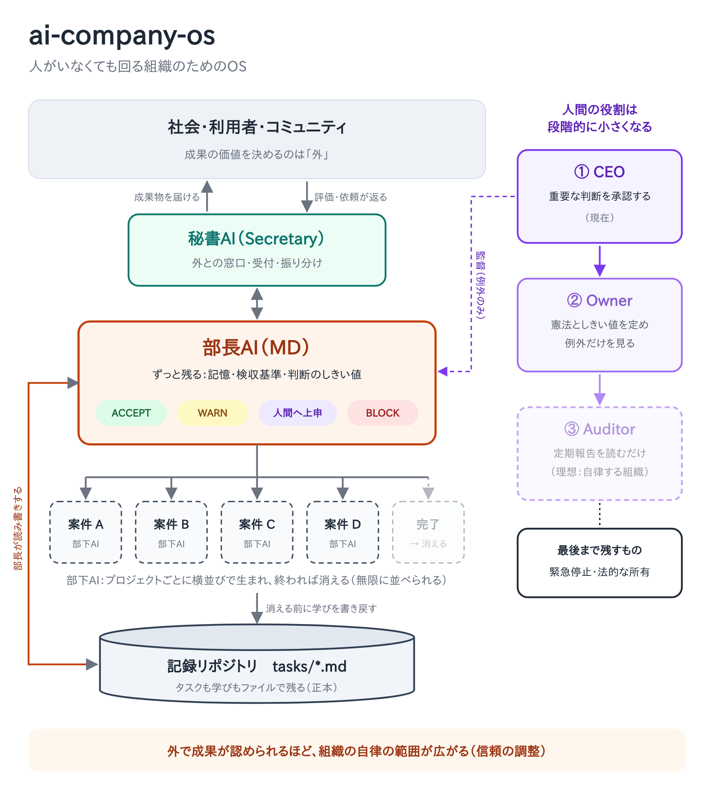

# ai-company-os

**人がいなくても回る組織のためのOS**
*An OS for an organization that keeps doing useful work without people.*



## 考え方 / The idea

- **価値を決めるのは外。** 仕事は、社会・利用者・コミュニティの役に立って初めて成立する。
- **設計の順番：** 成果 → 検収 → 成果物を作る人（エージェント）。
- **各層は1つだけ：** 秘書AI 1つ、部長AI 1つ。部長は増やさない。
- **部下は横並び。** 一度きりの仕事の部下は終われば消え、学びは消える前に記録へ書き戻す。繰り返し発生する種類の仕事には、同じ部下を雇い続けてよい（[`workers/README.md`](workers/README.md)）。
- **人間の役割は段階的に小さくする：** CEO → Owner → Auditor。緊急停止と法的な所有は最後まで人間に残す。

## OSとしての対応 / Mapping

| OS | ai-company-os |
|---|---|
| カーネル / kernel | 部長AI（MD）：記憶・検収基準・判断のしきい値 |
| プロセス / process | 使い捨ての部下AI（worker）：案件ごとに起動し、終われば消える |
| デーモン / daemon | 継続雇用の部下AI：繰り返し発生する種類の仕事を担い続ける |
| ファイルシステム / filesystem | `tasks/*.md`：タスクと学びの正本 |
| シェル・入出力 / shell, I/O | 秘書AI（secretary）：外との窓口 |
| 権限 / permissions | しきい値：ACCEPT / WARN / ESCALATE / BLOCK |
| アプリ / apps | 各プロジェクト |

## 構成 / Layout

```text
secretary/   秘書AIの役割定義
md/          部長AIの役割・検収基準・判断のしきい値
workers/     部下AIのテンプレート
tasks/       タスクをMarkdownファイルで管理する（正本）
docs/        図・設計メモ（design-notes.md：補足と未解決の論点）
```

## このOSと「インスタンス」の分け方 / Framework vs. instance

このリポジトリは **OSそのもの**（誰でも使える枠組み）です。実際に組織を動かすときは、利用者ごとに **非公開のインスタンス用リポジトリ** を別に用意し、部長AIの記憶・実際のタスク・プロジェクトの記録はそちらに置きます。
*This repository is the framework. Each organization that runs on it keeps its own private instance repository for the MD's memory, real tasks and project records.*

**判断基準は一つ：** 特定の利用者やプロジェクトを知らない人が、そのまま使えるか？
- 使える → このリポジトリ（役割の定義、テンプレート、しきい値の枠組み、運用ルール）
- 使えない → インスタンス用リポジトリ（記憶、実際のタスク、具体的なしきい値、人名・案件名）

**ルール / Rules**
- このリポジトリには、個人名・案件名・記憶・認証情報など、特定のインスタンスに固有の情報を書かない。
- 迷ったらインスタンス側に置く。公開はあとからでもできるが、取り消せない。
- インスタンスの運用で見つけた改善は、固有の情報を除いて一般化し、PRでこのリポジトリに戻す。

## 状態 / Status

構想段階です。まず1つのプロジェクトで試し、うまくいけば他へ広げます。
*Early concept. It will be piloted on one project first.*
